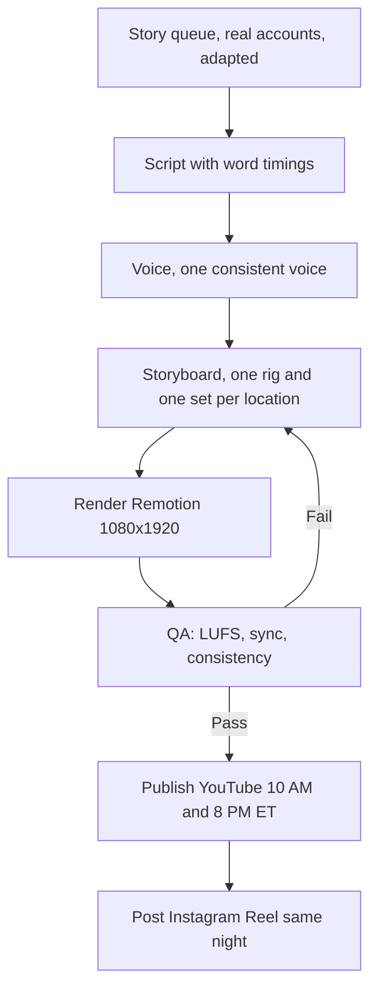

# Automated Content Generation and Publishing Agent

A fully automated nightly pipeline that turns a real first-person horror story into a vertical Short, renders it, checks quality, and publishes it to YouTube and Instagram.

Channel: YouTube @ithappentome, Instagram @it_happentome
Format: first-person horror, about 2 minutes, 1080x1920 vertical.

## Result in 10 seconds

- Published 16 Shorts on a fully automated schedule, as measured by 2 videos a day at 10:00 AM and 8:00 PM ET on YouTube with same-day Instagram Reels, by building a pipeline that sources real stories, scripts, voices, renders, and schedules each video.
- Improved consistency and sync, as measured by all cuts passing a 4-timestamp sync check and audio at -14.3 LUFS with peak under -1 dB, by fixing one rig and one set per location and building shot lists from word timings.
- Cut production to a nightly unattended run, as measured by 2 finished 1080x1920 vertical videos of about 2 minutes built and posted each night, by wiring story selection, Remotion rendering, QA review, and YouTube and Instagram publishing into one job.

## How it works in 30 seconds

1. Pick a story from the queue. Stories come from real people's accounts online, adapted in original words, never copied.
2. Build a script with word-by-word timings, in one consistent voice.
3. Build a storyboard with one character rig and one set per location. Check all stills side by side before animating.
4. Render with Remotion to 1080x1920 vertical. Audio is downsampled to 48 kHz before AAC encode.
5. Run QA on every video: loudness, sync, and consistency. A video that fails QA does not publish.
6. Publish to YouTube on schedule, and post the Instagram Reel the same night it is built.

## Workflow



Text version of the same flow, for a quick scan:

```
Story queue (real accounts, adapted)
  -> Script with word timings
  -> Voice (one consistent voice)
  -> Storyboard (one rig, one set per location)
  -> Render Remotion 1080x1920
  -> QA: LUFS, sync, consistency?
       Fail: Back to storyboard, fix, re-render
       Pass: Publish YouTube 10 AM and 8 PM ET -> Post Instagram Reel same night
```

## Key decisions

- Consistency is a system rule, not a prompt wish. One rig and one set per location, checked before animating, is what stops faces and props changing mid-video.
- Sync is built from word timings, not guessed after the render. The shot list comes from the narration, and every cut lands on a beat boundary.
- QA is a gate, not a report. A failed video never publishes.
- Long renders die if they log through a pipe. Detached jobs must log straight to a file, never through `tee`.
- Experiments run cleanly: one variable at a time. The current test is one normal video and one Gen Z slang video a day for a week, same story type, judged on views and watch time.

## Tech stack

Remotion (React / JavaScript), Python, YouTube Data API, Instagram API via Composio, FFmpeg, loudness QA.

## Repo structure

```
src/
  story_queue.py    # queued stories, source links, variety rules
  script.py         # script build with word timings
  storyboard.py     # one rig and one set per location, side-by-side still check
  render.py         # Remotion render driver, detached, logs straight to file
  qa.py             # LUFS check, 4-timestamp sync check, frame check
  publish.py        # YouTube schedule, Instagram immediate post, demo posts nothing
  remotion/
    Composition.js  # composition skeleton, 1080x1920, 30 fps
    render-demo.js  # Node demo render script, plan only
examples/
  sample-shot-list.json  # one sanitized shot list
  sample-qa-report.md    # what a passing QA report looks like
docs/
  architecture.md
  story-rules.md    # what makes a story work, learned from real posts
```

## Run the demo

```bash
npm install
npm run render -- --demo   # renders the sample composition plan, publishes nothing
python src/qa.py --demo    # runs the LUFS and sync checks on the sample
python src/publish.py --demo  # prints the schedule, posts nothing
```

Demo mode never posts to YouTube or Instagram. In demo mode the render step prints a plan only and does not render a video file.

## What is deliberately not in this repo

- Full story scripts (adapted from real posts, kept in the private queue)
- Voice API keys, YouTube / Instagram tokens, or session cookies
- Raw rendered videos. Watch them on the channel instead.
- The private story queue with source URLs
